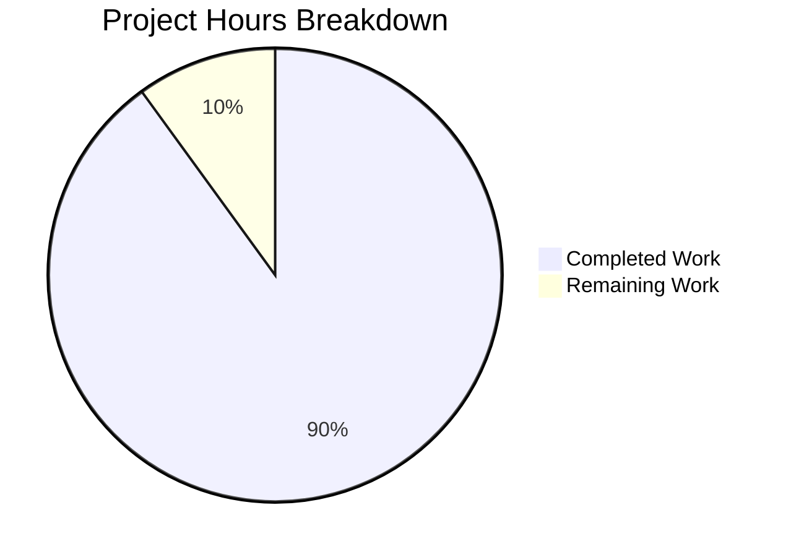

# 1. Executive Summary

## 1.1 Project Overview

A zero-dependency deliverable in five files. `hello_world.py` is a one-line program printing `Welcome to Blitzy`: 18 bytes, exit status 0, empty stderr. `hello_world.txt` is committed literal text carrying that line exactly 4000 times — 4000 LF-terminated lines, 72,000 bytes, one distinct value — and nothing in the repository generates it. A two-test standard-library suite enforces both byte for byte, a README documents the invariants and every read-only check, and `.gitignore` keeps interpreter caches out of the commit. No service, database, interface, build step or deployment target exists.

## 1.2 Completion Status

**90% complete** — 18.0 of 20.0 scoped hours delivered, all 22 scoped requirements met; the remaining 2.0 hours are the two items in Section 2.2.



*Completed = Dark Blue (#5B39F3); Remaining = White (#FFFFFF).*

| Metric | Hours |
| --- | --- |
| Total Hours | 20.0 |
| Completed Hours (AI + Manual) | 18.0 |
| Remaining Hours | 2.0 |

## 1.3 Key Accomplishments

- ✅ Exact stdout: 18 bytes — `Welcome to Blitzy` plus one LF — exit 0, empty stderr.
- ✅ Minimal source: 1 line, 26 characters, 27 bytes, no import or comment.
- ✅ Literal artefact: 4000 lines, 72,000 bytes, one distinct value, no CR, BOM, numbering or padding.
- ✅ No generator: no script, loop, template, task, hook or dependency produces the file.
- ✅ Reproducible: commit, working tree, archive export and clone carry identical bytes.
- ✅ Read-only verification: thirteen documented checks reproduce their exact results.

## 1.4 Critical Unresolved Issues

**6 of 24 scoped items** (22 requirement rows, 2 path-to-production) carry a caveat; none blocks release.

| Issue | Impact | Owner | ETA |
| --- | --- | --- | --- |
| Checkout-enforced preservation of the artefact's LF bytes is deferred (no `.gitattributes`) | Medium — a converting host would alter the working tree while the commit stays correct | Repository maintainer | Next maintenance pass (1.0 h) |
| The verification invocation context and a host-independent interpreter sentence are not yet stated in the documentation | Low — the gate run from another directory meets an internal interpreter error | Repository maintainer | Next documentation pass (1.0 h) |
| Four invariants have no automated assertion: stderr emptiness, source minimality, committed-blob read-back and a no-generator guard | Low — a regression there would pass the suite silently | Repository maintainer | With the next change to the artefact |
| The no-generator property is enforced by repository structure and whole-tree inspection rather than by a test | Low — a future writer would need review rather than a failing check | Repository maintainer | Whenever the file set changes |
| No linter, coverage tool, type checker or security scanner exists, and the zero-dependency rule forbids adding one | Low — style, coverage and security verdicts rest on inspection | Repository maintainer | If the dependency rule is ever relaxed |
| An early-closed pipe or unwritable stdout surfaces only as exit status 120 with the interpreter's message | Low — consumers must check the exit status rather than assume 0 | Caller | As encountered (no code change permitted) |

## 1.5 Access Issues

No access issues identified: no credential, service, database, network or privileged access is required, and no environment variable or secret is read.

## 1.6 Recommended Next Steps

1. **[High]** Confirm the artefact survives a real checkout on each host used; add `.gitattributes` if any converts line endings (1.0 h).
2. **[Medium]** State in the README that the checks run from the repository root, and lead with the portable interpreter floor (1.0 h).
3. **[Medium]** Decide whether the assertion set may grow; if so, cover stderr emptiness, the source bytes and the committed-blob read-back (2.0 h).
4. **[Low]** Keep git-lfs installed wherever this repository is developed; the four hooks exit 2 without it.
5. **[Low]** Note the README acceptance table as the manual gate in the review checklist.

# 2. Project Hours Breakdown

## 2.1 Completed Work Detail

| Component | Hours | Description |
| --- | --- | --- |
| `hello_world.py` — the program | 1.5 | Delivers the exact stdout contract: `Welcome to Blitzy` plus one LF, 18 bytes, exit status 0, empty stderr, from a single builtin call with no import, wrapper, argument surface or comment. |
| `hello_world.txt` — the literal artefact | 3.5 | Holds the line as committed literal content exactly 4000 times: 4000 LF-terminated lines, 72,000 bytes, one distinct line value, no carriage return, byte-order mark, numbering, padding or trailing whitespace, and no derivation behind it. |
| `tests/test_hello_world.py` — the verification module | 3.0 | One standard-library `TestCase` with two read-only methods and five assertions that bind the artefact's bytes, its 72,000-byte length, its freedom from carriage returns, the program's exit status and its captured stdout; binding power established by mutation testing. |
| `README.md` — the documentation | 3.0 | States both artefacts, the invariants with the bare values `4000` and `72000`, the CPython 3.12-or-later floor, the run command, the no-generation statement and all thirteen acceptance checks with their exact expected results, so a reviewer needs nothing else. |
| `.gitignore` — repository hygiene | 0.5 | The two patterns `__pycache__/` and `*.py[codz]`, which keep interpreter caches out of the committed set so the tracked files equal the delivered files. |
| Acceptance battery and committed-blob verification | 2.5 | The thirteen read-only checks plus the manual inspection, the committed-blob count, and reproduction of the artefacts from an archive export and a fresh clone with nothing executed while copying. |
| Program runtime invariance verification | 2.0 | Argument, stdin, output-transport, working-directory, environment, locale and encoding variants, repeated and concurrent runs, and runtime open/deny traces proving the program opens no data file and performs no network, subprocess or environment operation. |
| Whole-tree exclusion inventory | 2.0 | Establishes that no script, program, task, hook, test, build or install step or dependency can produce or rewrite the 4000 lines, and that the committed set is exactly the five mapped paths. |
| **Total** | **18.0** | |

## 2.2 Remaining Work Detail

| Category | Hours | Priority |
| --- | --- | --- |
| Checkout-enforced preservation of the artefact's LF bytes: confirm the bytes survive a real checkout on each host the team uses and, if any host applies line-ending conversion, add `.gitattributes` so the working tree cannot diverge from the committed content | 1.0 | Medium |
| Documentation of the verification invocation context and the interpreter requirement: state that the acceptance commands are run from the repository root, and reword the interpreter sentence so the portable floor leads and the verified interpreter reads as an observation of this checkout | 1.0 | Low |
| **Total** | **2.0** | |

**Calculation.** Completed 18.0 h + Remaining 2.0 h = **20.0 total project hours**; completion = 18.0 / 20.0 = **90.0%**. These figures are the single set used in Sections 1.2, 7 and 8. The two remaining items are path-to-production work the specification itself leaves open: the first is the hardening it names as the single file to add if checkout-filtered byte preservation is needed, the second completes its requirement that a reviewer can reproduce every acceptance check from the documentation alone. Optional enhancements that would exceed the fixed assertion set — extra test assertions, a static or coverage gate — are deliberately excluded from this total.

# 3. Test Results

| Area / Category | Framework | Tests | Passed | Failed | Coverage | What This Proves |
| --- | --- | --- | --- | --- | --- | --- |
| Literal data artefact — exact bytes, size and line endings (`hello_world.txt`) | Python standard-library `unittest` | 1 | 1 | 0 | n/a — the artefact is data, asserted whole | The committed 4000-line file is byte-equal to the expected line repeated 4000 times, 72,000 bytes, with no carriage return: exactness is proven over the whole file, not sampled. |
| Program stdout contract (`hello_world.py`) | Python standard-library `unittest` | 1 | 1 | 0 | 100% of the program's single executable statement (by inspection) | The program exits 0 and its captured stdout is exactly the mandated 18-byte line. |
| Documented suite gate from a clean checkout | `unittest` discovery, as documented in the README | 2 | 2 | 0 | n/a — a gate run | The repository's one gate collects exactly two checks and passes — with bytecode suppressed, with site and the environment isolated, and in an export of the commit. |
| Assertion binding power over mutated copies | `unittest` run against throwaway copies of the tree | 18 | 16 | 0 | n/a — mutation battery | 16 of the 18 mutated variants were rejected by the assertions — line count (3999/4001/4096), CRLF endings, byte-order mark, renumbering and padding, truncation, character-case change, byte substitution, empty file — so the checks bind the delivered bytes rather than restating them. |
| Read-only acceptance battery | POSIX text utilities and `git` | 14 | 14 | 0 | n/a — command checks | Every documented acceptance value reproduces exactly, including the 4000-line count read from the committed blob rather than from a checkout-converted working tree. |
| Program runtime invariance and adversarial inputs | Interpreter invocations with runtime audit tracing | 144 | 144 | 0 | n/a — invocation battery | The 18-byte output is invariant under argument noise, closed and fed stdin, four output transports, foreign and exotic working directories, scrubbed and hostile environments, locale and encoding variants, five repeated and eight concurrent runs, and no denied operation (network, subprocess, exec, environment write, write-open) triggers. |
| Artefact, repository surface and reproducibility | POSIX text utilities, `git`, interpreter | 186 | 186 | 0 | n/a — whole-tree verification | The committed blob, the working tree, an archive export and a fresh clone carry identical bytes for all five files; no artefact in the tree can execute a step or rewrite the data file; the committed set is exactly the five mapped paths. |
| Repository hygiene and the committed set | `git` | 7 | 7 | 0 | n/a — ignore and inventory checks | Bytecode caches are ignored at any depth while no deliverable is ignored, so the tracked set equals the delivered set and a suite run leaves the tree clean. |

Counts are of cases actually executed; the two mutated variants the fixed assertion set cannot distinguish are described below rather than counted as passes. No coverage percentage is reported because no coverage tool is installed and none may be added.

**Not Covered**

- **The program's stderr emptiness.** The suite asserts the exit status and captured stdout only; that stderr is empty is established by running the program and reading the acceptance checks, not by an assertion. A program that added stderr noise would still pass the suite.
- **The program's source minimality** (1 line, 26 characters, 27 bytes) and **the committed-blob read-back** are checked by the documented acceptance commands and by inspection, not by the test module.
- **The no-generator property** is enforced by the repository's structure — no writer exists anywhere in the tree — rather than by a test. A program that rewrote the artefact with identical bytes would pass; a human should re-run the whole-tree exclusion check whenever the file set changes.
- **Coverage as a measured number.** No coverage tool is installed and the zero-dependency constraint forbids adding one, so the coverage claim rests on inspection of the single executable statement.
- **Static quality gates.** No linter, formatter, type checker or security scanner exists on any host used for this work, and adding one would violate the zero-dependency constraint, so style and security verdicts rest on inspection.
- **The artefact's carriage-return assertion is subsumed** by the whole-file byte comparison, so it can never be the assertion that fails; byte equality is the load-bearing check.
- **A checkout with line-ending conversion enabled** is not exercised by any test. A human should confirm bytes on such a host, or add `.gitattributes` (Section 2.2).
- **No user interface, browser, service or endpoint surface exists**, so no screen, page flow or external integration was driven; the runtime surface is one terminal line and the bytes of five files.

# 4. Runtime Validation & UI Verification

- ✅ **Program execution** — `python3 hello_world.py` writes exactly 18 bytes (`57 65 6c 63 6f 6d 65 20 74 6f 20 42 6c 69 74 7a 79 0a`), exits 0 and leaves stderr empty; the same bytes were observed under argument noise (option-shaped, empty, unicode, 100 KB), closed and fed stdin, four output transports, foreign and exotic working directories, scrubbed and hostile environments, locale and encoding variants, and five sequential plus eight concurrent runs.
- ✅ **Literal artefact as data, and the no-generation proof** — 4000 lines and 72,000 bytes with one distinct line value, read from the working tree, the committed blob, an archive export and a fresh clone; running everything the repository offers leaves its digest, size and timestamps unchanged, and runtime traces record no write-open, no socket, no subprocess and no environment read by the program.
- ✅ **Suite gate from a clean checkout** — the documented discovery command reports `Ran 2 tests in 0.013s` / `OK` with exit 0, also with bytecode suppressed, with site and the environment isolated, and in an export of the commit.
- ✅ **Documentation contract** — every command the README documents reproduces its documented result, including the committed-blob count and the manual head/tail inspection.
- ✅ **Repository inventory and hygiene** — the tracked set is exactly the five mapped paths, interpreter caches are ignored at any depth while no deliverable is ignored, no excluded artefact exists, and no commit-time hook or filter can rewrite the data file.
- ⚠ **Early-closed pipe or unwritable stdout** — the process exits 120 with the interpreter's own `BrokenPipeError` or `OSError` message on stderr. The program deliberately defines no error path, so a caller should check the exit status rather than assume 0.
- ⚠ **Verification from another directory** — the documented gate command resolves `tests/` relative to the working directory: run from the repository root it passes, run elsewhere it fails inside the interpreter's own unittest with an internal `TypeError`. Pass an absolute start directory when invoking it from elsewhere.
- ⚠ **Line-ending conversion on checkout** — no attributes file is committed, so on a host that applies line-ending conversion the working tree would diverge from the committed bytes while the commit itself stays correct; verification should keep reading the committed blob (Section 2.2).
- ❌ **Not exercised at runtime: there is no browser, screen, page flow, HTTP endpoint, database, message queue or external service in this deliverable, so none was driven.** The whole runtime surface is the one printed line and the bytes of the five files, which is why the checks above are command-level observations.

# 5. Compliance & Quality Review

## 5.1 Compliance Matrix

| # | Deliverable | Benchmark | Verified Status | Basis |
| --- | --- | --- | --- | --- |
| 1 | Program stdout contract (`hello_world.py`) | Output exactness | ✅ PASS | 18 bytes, exit status 0, empty stderr; asserted by the test module and reproduced across invocation variants. |
| 2 | Source minimality (`hello_world.py`) | Constraint adherence | ✅ PASS | 1 line, 26 characters, 27 bytes, one builtin call, no import, wrapper or comment. |
| 3 | Literal artefact (`hello_world.txt`) | Byte exactness of committed content | ✅ PASS | 4000 LF-terminated lines, 72,000 bytes, one distinct value, no CR/BOM/numbering/padding, verified in the blob and the working tree. |
| 4 | No-generator property (whole tree) | Exclusion compliance | ✅ PASS | No writer, loop, substitution, template, task runner, hook, workflow or dependency can produce or rewrite the file. |
| 5 | Reproducibility and byte preservation on checkout (NFR-3) | Reproducibility | ⚠ PASS WITH CAVEAT | Blob, working tree, archive export and clone agree; no checkout-level enforcement exists, so a converting host would diverge (Section 2.2). |
| 6 | Dependency hygiene (NFR-2) | Supply chain | ✅ PASS | Standard library only; no manifest, lockfile, vendored code or install step; runs with site and the environment isolated. |
| 7 | Portability (NFR-4) | Platform floor | ✅ PASS | CPython 3.12-or-later floor stated and met (3.13.7 in this checkout); no version-specific syntax, no upper bound. |
| 8 | Program/data decoupling and cost constancy (NFR-5) | Design discipline | ✅ PASS | The program names no file, runs identically with the artefact absent or corrupted, and shows no cost dependence on it. |
| 9 | Security posture (NFR-6) | Attack surface | ✅ PASS | No input, arguments, environment reads, file access, subprocess, credentials or network; no secret or dependency exposure. |
| 10 | Maintainability (NFR-7) | Simplicity | ✅ PASS | Content exists only as the literal file; no template, data source or abstraction to maintain. |
| 11 | Verification module (`tests/test_hello_world.py`) | Test quality and read-only discipline | ✅ PASS | Two read-only methods, five assertions, standard library only, no package marker, binding power demonstrated by mutation; the gate reports `Ran 2 tests … OK`. |
| 12 | Documentation and repository hygiene (`README.md`, `.gitignore`) | Documentation completeness and a clean committed set | ✅ PASS | Both invariants with their values, the run command, all thirteen checks with expected results and the no-generation statement; the tracked set equals the delivered set. |

## 5.2 AAP & Rule Divergences and Gaps

No user-specified rules exist for this project — the rules document is empty — so every divergence below is measured against the project's technical specification. Six were found; none blocks release, and none changes a delivered byte.

| # | What the AAP/Rule Required | What Was Delivered Instead | Why It Diverged | Impact | Remediation |
| --- | --- | --- | --- | --- | --- |
| D1 | The instruction under which the documentation file was written was to keep its pre-existing first line as the document title | The file's first line is `# Welcome to Blitzy` (`README.md:1`); the retained scaffold heading is gone | The retained line was platform residue — the repository-name heading of the stub that occupied the path before this work — and the specification sets no requirement on the heading text | None: the document is self-describing and no requirement depends on the old text | None. Recorded so the change is deliberate rather than accidental |
| D2 | The specification states the environment's interpreter as Python 3.12.3, at the same interpreter location the host uses (0.1.1 NFR-4, 0.3.1) | The documentation states the CPython 3.12-or-later floor with no upper bound plus the verified interpreter, Python 3.13.7 (`README.md:23`) | The host provides 3.13.7; the binding rule is the 3.12-or-later floor, the interpreter is a given resource, and pinning a version would need a manifest the zero-dependency rule forbids | None on the deliverable: every requirement is met. Only the specification's stated patch version is not what the host provides | None required. If a specific build must be pinned, the dependency rule has to be relaxed first |
| D3 | The exclusion inventory expects `.git/hooks` to hold only the sample files Git creates (0.8.2) | The clone also carries four live git-lfs hook shims, installed by the host image | The platform installs them and forbids deleting them; without git-lfs on `PATH` they exit 2 and block commits and pushes | None: no hook names or can write the data file, no LFS attribute exists, and the artefact is a plain 72,000-byte blob | None. Keep git-lfs installed wherever this repository is developed |
| D4 | The file plan describes every planned file as a CREATE on a repository built from nothing (0.9.1) | `README.md` was delivered as an update of a 49-byte stub already on the branch (`M` in `git diff --name-status`) | The path already existed when the documentation was written, so the operation that produced the delivered content is an update | None: same path, same heading level, and the delivered content satisfies every documentation requirement | None. The remaining four paths are additions, as planned |
| D5 | The specification deliberately declines `.gitattributes` and LFS configuration, accepting that the line contract is verified against the committed blob rather than enforced on checkout (0.5.1, 0.8.2) — **Sanctioned** | No attributes file is committed; `git check-attr -a` returns nothing and the commit carries plain text | The specification's own minimality decision: 72,000 bytes is far below large-file thresholds, and a checkout filter would add a file nothing in the request asks for | Low but real: on a host with line-ending conversion the working tree would diverge from the committed bytes, and the test module reads the working tree | Confirm bytes on each development host; add `.gitattributes` (`hello_world.txt text eol=lf`) if a converting host must be supported — 1.0 h (Section 2.2) |
| D6 | One proof command in the exclusion inventory embeds a carriage-return escape inside a regular expression (0.8.2), expecting no match | The file's bytes are exactly the mandated content (1 line, 26 characters, 27 bytes), and the check's intent is proven with a carriage-return-only pattern, which reports 0, and an octal dump showing one terminating newline | GNU `grep -E` reads that escape as the literal letter `r`, which the mandated word `print` necessarily contains, so the command as literally written cannot pass; the mandated exact content outranks a check that cannot pass | None: the property the check exists to prove holds and is proven by an equivalent command | None. Use a carriage-return-only pattern in any future check |

**D1 — the documentation heading.** The file replaced a two-line platform stub whose first line was the repository's own scaffold name, and keeping that line would have left the document opening with a machine-generated identifier rather than with the deliverable's name. The heading now reads `# Welcome to Blitzy` (`README.md:1`), the same string the program prints. No requirement constrains the heading, no consumer reads it, and the change is confined to one line — the program, the artefact and the suite are untouched. No action is needed; the entry is recorded so a reader comparing the file with its earlier revision knows the retitle was deliberate.

**D2 — the interpreter statement.** The specification fixes the portability rule as "CPython 3.12 or later, no upper bound" and, in the same section, quotes the environment's interpreter as Python 3.12.3. The host provides 3.13.7 at the same interpreter location, which satisfies the rule. The documentation states the floor first and then the interpreter this checkout actually runs (`README.md:23`), so nothing a reader is told is false. Editing the host interpreter is not something this work may do, and pinning a version in the repository would require the manifest the zero-dependency rule forbids. A human needs to decide only whether a specific interpreter build must ever be guaranteed; today it need not be.

**D3 — the hook directory.** The exclusion inventory expected `.git/hooks` to hold only Git's sample files, as a way of proving that no hook could rewrite the artefact. This clone also carries four git-lfs hook shims installed by the host image, which the platform requires for its commit and push flow and which must not be deleted — without git-lfs on `PATH` they exit 2 and would block both. The property the check exists to establish does hold: each shim only delegates to git-lfs, no hook references the deliverable, no path carries an LFS attribute, and the committed artefact is a plain 72,000-byte blob rather than a pointer. Nothing needs changing; the entry exists so a later reader does not read the directory as a failed check.

**D4 — the file operation.** The file plan presents all five paths as new files on a repository built from nothing. In fact one path — the documentation file — already existed as a 49-byte platform stub, so the work updated it in place rather than creating it; the diff accordingly records one modification and four additions. Nothing about the delivered content is affected: the path, the heading level and every documented value are as planned, and no other pre-existing file was touched, renamed or deleted. No remediation is needed. The entry is recorded because a reviewer comparing the specification's wording with the commit graph would otherwise see a discrepancy and no explanation for it.

**D5 — the deliberately omitted attributes file (sanctioned).** The specification explicitly declines `.gitattributes` and LFS configuration, accepting that the artefact's line contract is verified against the committed blob rather than enforced at checkout, and this work followed that decision. The consequence is specific and worth knowing: the whole-file byte assertion in the test module reads the working tree, so on a host whose Git configuration converts line endings the suite would fail while the commit itself remains correct. Here no conversion applies — `git ls-files --eol` reports LF in both the index and the working tree, and no attributes are set. A human should confirm bytes on every host used for development, and add the attributes file if a converting host must be supported.

**D6 — a proof command that cannot pass as written.** The exclusion inventory includes a search for carriage returns written as a regular-expression escape. Under GNU `grep -E` that escape is read as the literal letter `r`, which the mandated statement contains in the word `print`, so the command reports a match no matter what the file holds. The bytes were not altered to satisfy it: the file is exactly the mandated one line, 26 characters and 27 bytes, and the intent — no carriage return anywhere — is proven by a carriage-return-only pattern (0 matches, exit 1) and by an octal dump showing a single terminating newline. Nothing needs changing in the deliverable; future checks of this kind should use the carriage-return-only form.

# 6. Risk Assessment

| Risk | Category | Severity | Probability | Mitigation | Status |
| --- | --- | --- | --- | --- | --- |
| A checkout with line-ending conversion enabled presents a converted working tree while the commit stays correct, so the suite's whole-file assertion would fail on that host | Technical / Integration | Medium | Low | Keep verification pointed at the committed bytes (`git cat-file blob HEAD:hello_world.txt`); add `.gitattributes` (`hello_world.txt text eol=lf`) if such a host must be supported | Accepted residual risk, documented; 1.0 h in Section 2.2 |
| Marking the artefact for Git LFS in future would make a checkout yield a pointer instead of 4000 lines, breaking the count, size and byte claims at once | Technical / Operational | High | Very Low | Treat any change to attributes or filters as a reviewable event; verify that the committed blob's content is literal text, never a pointer | Watch item; no LFS attribute exists today |
| The same fact lives in three places — the program's literal, the 4000-line artefact and the test module's constants — and nothing keeps them in step | Technical / Maintainability | Low | Medium | After any edit to the string or the count, run the suite and the README acceptance table; both compare the artefacts against fixed expectations | By design: the count is deliberately not centralised |
| Four invariants have no automated assertion (stderr emptiness, source minimality, committed-blob read-back, no-generator guard) and no linter, coverage tool or scanner exists, so a regression in those areas would pass the gate unnoticed | Technical / Verification | Low | Medium | Run the README acceptance table at review time; grow the assertion set only if the fixed set is allowed to change (2.0 h, outside the scoped remainder) | Accepted by design under the zero-dependency rule |
| The four git-lfs hooks installed in the clone exit 2 when git-lfs is missing from `PATH`, which would block commits and pushes | Operational | Medium | Low | Keep git-lfs installed on every host that develops this repository; never delete the hooks | Host setup, inert while git-lfs is present |
| A consumer that closes the pipe before the program flushes, or an unwritable stdout, exits 120 with the interpreter's own message on stderr instead of a clean failure | Operational / Integration | Low | Low | Consume the line, or check the exit status rather than assuming 0; both behaviours are documented for callers | Interpreter-level by design: the program defines no error path and adding one would break the one-line contract |
| The program depends on `python3` being on `PATH`, and the repository declares nothing because a manifest, lockfile or wrapper is forbidden | Operational | Low | Low | The documentation states the CPython 3.12-or-later floor and the interpreter verified in this checkout | Accepted by design (zero dependencies) |
| Material security risk | Security | Informational | Very Low | None required: the deliverable has no input surface, no arguments, no environment reads, no credentials, no network call and no third-party dependency, so no injection, supply-chain or data-exposure path exists | Assessed; no exposure identified |

# 7. Visual Project Status

**Completion by hours** — 18.0 completed of 20.0 total, **90% complete**. The same figures appear in Sections 1.2 and 2.2; the chart below is generated from them.


*Chart convention: Completed = Dark Blue (#5B39F3), Remaining = White (#FFFFFF).*

**Remaining hours by category** (from Section 2.2):

| Category | Hours | Priority |
| --- | --- | --- |
| Checkout-enforced preservation of the artefact's bytes | 1.0 | Medium |
| Verification context and interpreter wording in the documentation | 1.0 | Low |
| **Total** | **2.0** | |

**Status by capability:**

| Capability | Status |
| --- | --- |
| Program stdout contract — 18 bytes, exit 0, empty stderr | ✅ Verified |
| Literal 4000-line, 72,000-byte artefact | ✅ Verified |
| Two-test read-only verification gate | ✅ Verified |
| No-generator property across the whole tree | ✅ Verified |
| Reproducibility from a clean checkout | ✅ Verified |
| Documentation of invariants and acceptance checks | ✅ Verified |
| Byte preservation on checkout | ⚠ Deferred (1.0 h) |
| Verification context and host-independence of the documentation | ⚠ Deferred (1.0 h) |

# 8. Summary & Recommendations

**What was delivered and verified.** The repository holds exactly five files, and every promise they make has been exercised. `hello_world.py` writes the single line `Welcome to Blitzy` to standard output — 18 bytes, exit status 0, nothing on stderr — and does so invariantly under argument noise, closed and fed stdin, four output transports, foreign working directories, scrubbed and hostile environments, locale and encoding variants, and sequential as well as concurrent runs. `hello_world.txt` carries that line as committed literal text exactly 4000 times: 4000 LF-terminated lines, 72,000 bytes, one distinct line value, no carriage return, byte-order mark, numbering, padding or trailing whitespace, with the same bytes in the working tree, the commit, an export of the commit and a fresh clone. Running everything the repository offers leaves those bytes and their timestamps untouched, so no script, task, hook, test or dependency produces them. A two-test standard-library suite enforces both artefacts and rejects mutated variants of each, and every one of the thirteen documented acceptance checks reproduces its stated result from the repository root.

**How the work stands against the specification.** All 22 requirements in scope are met — the exact output contract, the minimal source, the literal artefact, the absence of any generator, dependencies, reproducibility, portability, decoupling, security posture, maintainability, the five-file plan and the documentation — and no requirement was skipped or deferred. Measured in hours, 18.0 of 20.0 are complete, so the project stands at **90% complete**: the outstanding 2.0 hours are two path-to-production items the specification itself leaves open rather than unmet requirements — confirming the artefact's bytes survive a real checkout on each development host and, if any host converts line endings, adding an attributes file; and completing the documentation with the invocation context and a host-independent interpreter sentence. Six divergences are recorded in Section 5.2; none changes a delivered byte, and four of them are statements in the specification's own text that the delivered repository does not match rather than work left undone.

**What remains before this is release-final.** The critical path is short and entirely in the maintainer's hands. First, confirm bytes on every host the team uses and add the attributes file if a converting host must be supported — this is the only item that could make a fresh checkout disagree with the commit, and it costs about an hour. Second, finish the documentation pass so a reader can reproduce every check from any directory and so the interpreter requirement reads as a portable floor rather than a property of one machine. Third, decide deliberately whether the assertion set may grow; if it may, assertions for stderr emptiness, the program's source bytes and the committed-blob read-back would turn the last three manually checked invariants into mechanical ones. None of these items affects the bytes already committed.

**Success metrics.** Exactness is proven over whole files rather than samples: whole-file byte equality for the artefact, an exact 18-byte comparison for the program, and a 4000-line count read from the committed object as well as from the working tree. Reproducibility is proven by four independent copies of the same bytes and by the gate passing in an export of the commit with nothing executed while copying. Constraint adherence is proven by absence: no manifest, lockfile, task runner, workflow, container, template, hook of its own or third-party dependency exists anywhere in the tree, and the program contains no import at all. Verification is read-only: every documented command leaves all five files byte-identical, and the only working-tree trace a run can leave is the ignored bytecode cache the documentation names.

**Production readiness.** Ready for delivery on its own terms. This is a constraint exercise rather than a service — by design it has no interface surface, no state, no network use and no operational footprint beyond one printed line — and within that scope it is exact, reproducible and self-documenting. A reviewer should read the accepted caveats as the repository's honest boundary rather than as defects: the byte contract is verified against the commit instead of enforced at checkout, four invariants are verified by command rather than by assertion, and the program inherits the interpreter's behaviour for an unwritable or early-closed stdout. Closing the two remaining items moves it from delivered to release-final; nothing else stands between the reader and the codebase.

# 9. Development Guide

Every command below was executed in this checkout and is quoted with the output it produced. All commands are run from the repository root unless a step says otherwise.

## 9.1 System Prerequisites

- **CPython 3.12 or later** on a POSIX host, with no upper bound. This checkout was built and verified on Python 3.13.7:

  ```bash
  python3 --version
  # Python 3.13.7
  ```

- **`git`** and the POSIX text utilities `wc`, `sort` and `grep`, which the verification checks use. All four must be on your `PATH`: `command -v git wc sort grep` prints one location per tool.
- No container, database, cache, message queue or network access is required, and no port is bound at any point.

## 9.2 Environment Setup and Dependency Installation

There is nothing to install and no environment to configure. The program and the test module use the Python standard library alone, so the repository holds no manifest, no lockfile and no third-party dependency, and there is no virtual environment, build step or generated file.

```bash
git ls-files
# .gitignore
# README.md
# hello_world.py
# hello_world.txt
# tests/test_hello_world.py
```

If your host applies line-ending conversion on checkout, read Section 9.6 before relying on the byte counts in Section 9.4.

## 9.3 Running the Program

```bash
python3 hello_world.py
# Welcome to Blitzy
```

The output is exactly `Welcome to Blitzy` followed by one newline — 18 bytes — with nothing on stderr and exit status 0. The capture files below go to a scratch directory of your own, so nothing lands in the repository:

```bash
D="$(mktemp -d)"
python3 hello_world.py > "$D/out.bin" 2> "$D/err.bin"; echo "exit=$?"
# exit=0
wc -c "$D/out.bin" "$D/err.bin"
# 18 <scratch>/out.bin
#  0 <scratch>/err.bin
od -An -tx1 "$D/out.bin"
#  57 65 6c 63 6f 6d 65 20 74 6f 20 42 6c 69 74 7a
#  79 0a
```

The program takes no arguments, reads no environment variable and opens no file; it behaves identically when the data file is absent.

## 9.4 Verification Steps

Run the test gate — the repository's only automated check:

```bash
python3 -m unittest discover -s tests -p "test_*.py"
# ..
# ----------------------------------------------------------------------
# Ran 2 tests in 0.013s
#
# OK
```

It must be run from the repository root. Discovery imports the test module, which writes an ignored `tests/__pycache__/` bytecode cache; `python3 -B -m unittest discover -s tests -p "test_*.py"` (or `PYTHONDONTWRITEBYTECODE=1`) suppresses even that and still reports `OK`.

Run the acceptance checks — each is read-only and reproduces the result shown:

```bash
wc -l hello_world.txt          # 4000 hello_world.txt
wc -c hello_world.txt          # 72000 hello_world.txt
sort -u hello_world.txt | wc -l
# 1
grep -c -x -F "Welcome to Blitzy" hello_world.txt
# 4000
grep -c $'\r' hello_world.txt
# 0            (grep exits 1 when nothing matches — expected here)
wc -l hello_world.py           # 1 hello_world.py
wc -c hello_world.py           # 27 hello_world.py
python3 hello_world.py | wc -c
# 18
git cat-file blob HEAD:hello_world.txt | wc -l
# 4000         (reads the committed object, not the working tree)
grep -c -x -F -e "__pycache__/" -e "*.py[codz]" .gitignore
# 2
grep -o -e "python3 hello_world.py" -e 4000 -e 72000 README.md | sort -u | wc -l
# 3
head -3 hello_world.txt | cat -A
# Welcome to Blitzy$
# Welcome to Blitzy$
# Welcome to Blitzy$
head -c 3 hello_world.txt | od -An -tx1
#  57 65 6c    (not a byte-order mark)
```

Reproduce the artefacts from the commit without executing anything in the copy:

```bash
CLEAN="$(mktemp -d)"
git archive HEAD | tar -x -C "$CLEAN"
cd "$CLEAN" && python3 hello_world.py | wc -c && wc -l hello_world.txt && python3 -m unittest discover -s tests -p "test_*.py"
# 18
# 4000 hello_world.txt
# Ran 2 tests in 0.013s
#
# OK
```

## 9.5 Example Usage

Pipe the line into another command, capture it in a script, or compare it against a reference built independently:

```bash
python3 hello_world.py | cat
# Welcome to Blitzy
python3 hello_world.py | cmp - <(printf 'Welcome to Blitzy\n') && echo "byte-identical"
# byte-identical
OUT="$(python3 hello_world.py)"; printf '%s\n' "${#OUT} characters"
# 17 characters   (the shell strips the trailing newline)
```

## 9.6 Troubleshooting

- **`TypeError: expected str, bytes or os.PathLike object, not NoneType` (exit 1) when running the gate.** The command was run from a directory other than the repository root, and `-s tests` is relative. Run it from the repository root, or pass the absolute path of the checkout's `tests` directory to `-s` instead, which reports `Ran 2 tests … OK`. Do not add `-t` to the relative form: `tests/` is deliberately not a package, so `-t .` fails with `ImportError: Start directory is not importable`.
- **`TypeError` (exit 1) or `NO TESTS RAN` (exit 5) on a fresh clone.** The `tests/` directory is missing or empty. Check out the branch fully; neither message is an environment fault.
- **`grep -c $'\r' hello_world.txt` prints `0` and the shell reports failure.** That is the expected outcome: the non-zero status means "no match". Use `grep -c $'\r' hello_world.txt || true` in a script that treats a non-zero status as an error.
- **`wc -c hello_world.txt` is not 72000, or `wc -l` is not 4000.** Your checkout is being converted on the way out. Confirm the committed bytes with `git cat-file blob HEAD:hello_world.txt | wc -c` (72000) and `git ls-files --eol | grep hello_world.txt` (expect LF in both the index and the working tree), then add `hello_world.txt text eol=lf` to a new `.gitattributes` if the host must stay as it is.
- **`python3 hello_world.py | head -c 0` reports exit 120.** The reader closed the pipe before the interpreter flushed stdout; the interpreter prints `BrokenPipeError` on stderr. The same happens when stdout cannot be written at all — redirecting into a full device gives exit 120 with `OSError: [Errno 28] No space left on device`. The program defines no error path, so a caller should check the exit status rather than assume 0.
- **A stray `tests/__pycache__/` appears after a run.** That is the interpreter's bytecode cache, ignored by `.gitignore`; `git status --porcelain` stays empty. Remove it with `rm -rf tests/__pycache__`, or suppress it with `python3 -B` or `PYTHONDONTWRITEBYTECODE=1`.
- **`pip install` is refused with `externally-managed-environment`.** Nothing needs installing; the deliverable uses the standard library only and the constraint forbids adding a dependency.

# 10. Appendices

## Appendix A. Command Reference

| Command | Purpose | Expected result |
| --- | --- | --- |
| `python3 hello_world.py` | Run the program | `Welcome to Blitzy`, exit 0, empty stderr |
| `python3 hello_world.py \| wc -c` | Output size | `18` |
| `python3 -m unittest discover -s tests -p "test_*.py"` | The repository's only gate; run from the repository root | `Ran 2 tests … OK`, exit 0 |
| `python3 -B -m unittest discover -s tests -p "test_*.py"` | The gate without leaving a bytecode cache | `OK`, exit 0 |
| `wc -l hello_world.txt` / `wc -c hello_world.txt` | Line count and byte size of the artefact | `4000` / `72000` |
| `sort -u hello_world.txt \| wc -l` | Distinct line values | `1` |
| `grep -c -x -F "Welcome to Blitzy" hello_world.txt` | Whole-line matches | `4000` |
| `grep -c $'\r' hello_world.txt` | Carriage returns | `0` (grep exits 1 — expected) |
| `wc -l hello_world.py` / `wc -c hello_world.py` | Source minimality | `1` / `27` |
| `git cat-file blob HEAD:hello_world.txt \| wc -l` | Line count from the committed object | `4000` |
| `git ls-files` | Committed set | `.gitignore`, `README.md`, `hello_world.py`, `hello_world.txt`, `tests/test_hello_world.py` |
| `git ls-files --eol` | Line-ending state per path | `i/lf w/lf attr/` for all five paths |
| `git archive HEAD \| tar -x -C <dir>` | Reproduce the artefacts without executing anything | Five identical files |
| `head -3 hello_world.txt` / `tail -3 hello_world.txt` | Manual inspection | Three undecorated lines each |
| `head -c 3 hello_world.txt \| od -An -tx1` | Byte-order-mark check | `57 65 6c` |

## Appendix B. Port Reference

None. The deliverable binds no TCP or UDP port, opens no listening socket, starts no server and contacts no host. A port probe after the program runs reports no listening socket, and there is no port to configure.

## Appendix C. Key File Locations

| Path | Role | Size |
| --- | --- | --- |
| `hello_world.py` | The program — one statement, the repository's only executable artefact | 27 bytes, 1 line |
| `hello_world.txt` | The literal artefact — the line as committed text exactly 4000 times | 72,000 bytes, 4000 lines |
| `tests/test_hello_world.py` | The verification module — two read-only methods, five assertions | 1,177 bytes, 33 lines |
| `README.md` | Deliverable documentation — invariants, run command and every acceptance check | 4,421 bytes, 73 lines |
| `.gitignore` | Repository hygiene — keeps interpreter caches out of the committed set | 24 bytes, 2 lines |

## Appendix D. Technology Versions

| Component | Version | Notes |
| --- | --- | --- |
| CPython | 3.13.7 | Satisfies the CPython 3.12-or-later requirement; no upper bound |
| `unittest`, `subprocess`, `sys`, `pathlib` | Shipped with CPython | The test module's only imports; no third-party package |
| `git` | 2.54.0 | Used by the repository and the verification checks |
| POSIX text utilities (`wc`, `sort`, `grep`, `od`, `head`, `tail`) | Host versions | Used only by the read-only checks; nothing in the repository invokes them |
| Declared dependencies | None | No manifest, lockfile, virtual environment or install step |

## Appendix E. Environment Variable Reference

The program reads no environment variable, and the test module reads none either. No configuration file of any kind is needed. The variables below are interpreter-level conveniences only; none is required, and the output is identical with them unset.

| Variable | Effect | When to use |
| --- | --- | --- |
| `PYTHONDONTWRITEBYTECODE` | Prevents the bytecode cache a suite run otherwise writes into `tests/__pycache__/` | On a read-only or cache-hostile checkout |
| `PYTHONIOENCODING` | Forces the interpreter's stdout encoding | Only for diagnostics; forcing a non-default encoding changes the byte stream without any change to the program |

## Appendix F. Developer Tools Guide

| Need | What to use | Notes |
| --- | --- | --- |
| Syntax check | `python3 -m py_compile hello_world.py tests/test_hello_world.py` | Interpreted project: there is no build step, and this is its whole compilation surface |
| Run the tests | `python3 -m unittest discover -s tests -p "test_*.py"` | The documented gate; run from the repository root |
| Inspect bytes | `od -An -tx1`, `od -c`, `cat -A` | The only reliable way to check the artefact's bytes and the program's output |
| Linters, formatters, type checkers, coverage, security scanners | None installed, and none may be added | The zero-dependency constraint forbids introducing one; style, coverage and security are established by inspection and by the acceptance checks |
| Editor | Any | The whole source is a single line; `.gitignore` already excludes interpreter caches from your diffs |

## Appendix G. Glossary

| Term | Meaning |
| --- | --- |
| The artefact | `hello_world.txt`, the committed literal file carrying the line exactly 4000 times |
| The program | `hello_world.py`, the one-line program that writes the line to standard output |
| The gate | `python3 -m unittest discover -s tests -p "test_*.py"`, the repository's only automated check |
| No-generator property | No script, program, task, hook, test, build or install step or dependency produces the file's lines |
| LF | The single newline byte (`0a`) terminating every line, including the last |
| Committed blob | The exact bytes Git stores for a path — `git cat-file blob HEAD:<path>` — as opposed to what a checkout presents |
| Byte-order mark (BOM) | An optional leading byte sequence that would invalidate the line's exact content |
| Read-only check | A verification command that writes, moves, truncates or reformats nothing it inspects |
